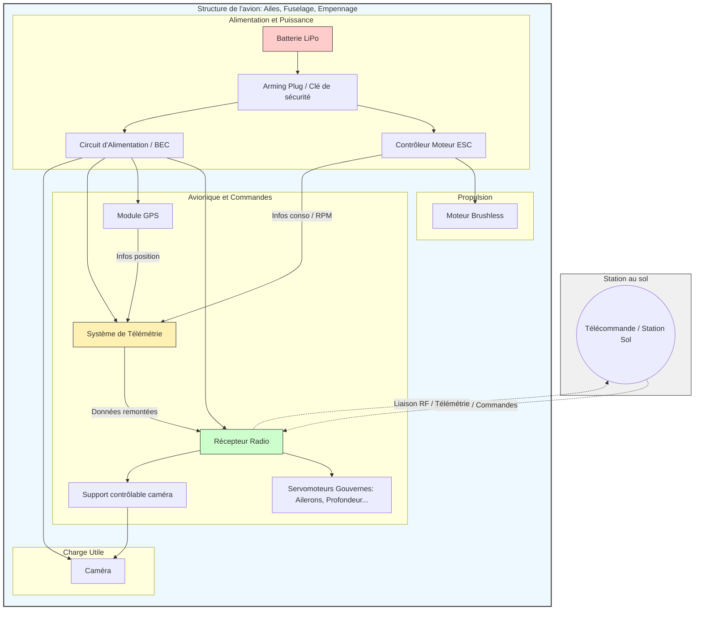

# Avion RC

[](https://www.gnu.org/licenses/gpl-3.0.html)

Projet étudiant de conception d'un avion radiocommandé dans le cadre du projet de 2A en électronique.

> **État du projet :** phase de cadrage et de conception préliminaire.

## Table des matières

- [Présentation](#présentation)
- [Cahier des charges](#cahier-des-charges)
- [Architecture du projet](#architecture-du-projet)
- [Organisation du dépôt](#organisation-du-dépôt)
- [Documentation](#documentation)
- [Auteurs et contributeurs](#auteurs-et-contributeurs)
- [Licence](#licence)
- [Rapport de projet (pour les encadrants)](#rapport-de-projet-pour-les-encadrants)

## Présentation

### Contexte

Ce projet est réalisé dans le cadre du projet de 2A à l'ENSEA (École Nationale Supérieure de l'Électronique et de ses Applications). Il a pour objectif de concevoir un avion radiocommandé en portant une attention particulière à sa partie électronique.

### Description du système

L'avion sera équipé d'une charge utile, à priori une caméra destinée à la cartographie. Le choix définitif du type d'avion et des fonctions embarquées sera précisé au cours de la phase de conception.

### Public visé

Ce dépôt est destiné principalement à l'équipe projet et aux enseignants. Il vise également les personnes intéressées par l'aéronautique et les projets d'avions radiocommandés qui découvriraient le projet sur GitHub.

## Cahier des charges

[Cahier des charges](documentation/cahier-des-charges.pdf) 

## Architecture du projet



## Organisation du dépôt

Le dépôt regroupera l'ensemble des éléments du projet :

```text
.
├── electronique/       # Schémas KiCad, PCB, Gerber, BOM et datasheets
├── mecanique/          # CAO, plans et fichiers de fabrication
├── documentation/      # documentation du projet et rapports
└── README.md           # Présentation générale du projet
```

## Documentation

### Choix des logiciels

- [GitHub Project]() : outil de gestion de projet intégré à GitHub pour le suivi des tâches et des fonctionnalités.
- [KiCad](https://kicad.org/) : logiciel libre de conception de circuits imprimés (PCB) et de schémas électroniques.
- [FreeCAD](https://www.freecad.org/) : logiciel libre de modélisation 3D paramétrique pour la conception mécanique.
  
## Auteurs et contributeurs

### Équipe projet

[Emylie HIRON](https://github.com/EmylieHiron)

[Sofia MABROUK](https://github.com/sofia-mabrouk)

[Alain PIALLAT](https://github.com/AlainPiallat)

[Melvin SAYAVONG](https://github.com/Saymel367)

## Licence

[GNU General Public License v3.0](https://www.gnu.org/licenses/gpl-3.0.html)

## Rapport de projet (pour les encadrants)

Les documents destinés au suivi et à l'encadrement du projet seront regroupés dans la documentation dédiée :

- [Cahier des charges](documentation/cahier-des-charges.pdf)
- [Planning et organisation]()
